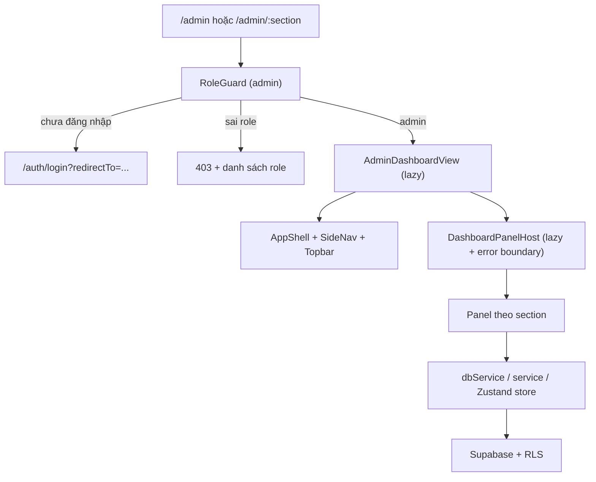
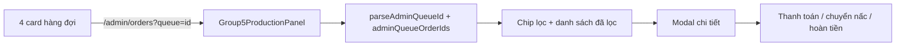
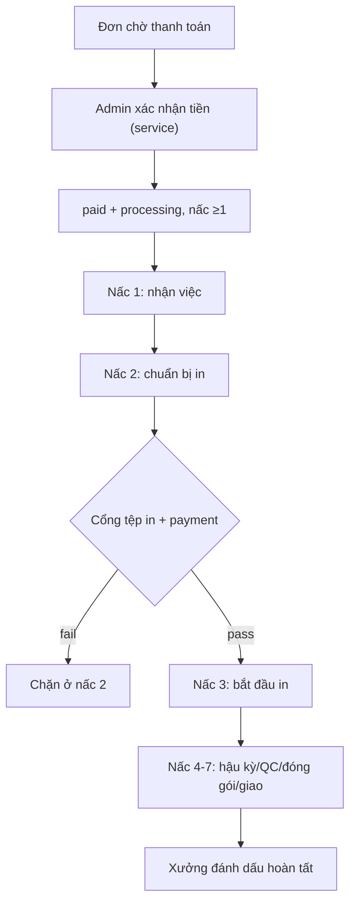
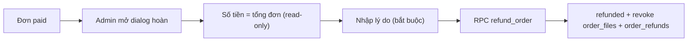
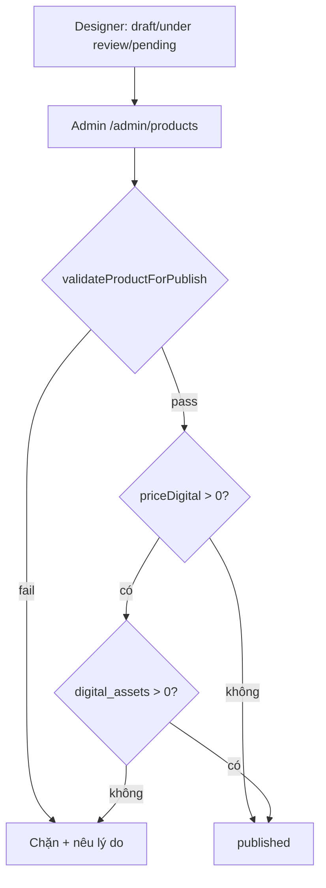

<!-- doc-meta: status=active; verified=2026-11-13; owner=agent; scope=admin-console -->
# `/admin` — Phân tích hợp nhất: UI · Logic · Flow

> **Mục đích:** một tài liệu duy nhất trả lời “`/admin` có gì, chạy bằng dữ liệu nào, bấm nút thì đi tới đâu, chỗ nào còn giả/chưa nối nguồn”.
>
> **Phạm vi:** mọi thứ dưới `/admin` — route, guard, shell, 16 mục nav, 23 section URL, 23 tab nội bộ, 44 file trong `src/frontend/components/admin/`, các store/service/DB mà console gọi tới.
>
> **Quan hệ tài liệu:** bản đồ ngắn ở [`admin-portal.md`](./admin-portal.md); quyết định IA ở [`ADMIN-IA-REVISION.md`](../po/marketplace/ADMIN-IA-REVISION.md); hợp đồng DB/tiền ở [`ADMIN-CONTRACTS.md`](../security/ADMIN-CONTRACTS.md) và [`MONEY-AND-SETTLEMENT.md`](../po/marketplace/MONEY-AND-SETTLEMENT.md). Tài liệu này gộp lại và đi sâu vào source hiện tại.
>
> **Bằng chứng:** đọc source tại working tree ngày **2026-11-13**. Không chạy browser, không đăng nhập admin thật, không đo DB trong task này.
> - `FACT` = đọc thấy trong source/DDL.
> - `INFERENCE` = suy ra từ luồng code, chưa bấm thử.
> - `NOT RUN` = chưa có bằng chứng runtime.

---

## 0. TL;DR

- **Một cửa vào, một role:** `/admin` và `/admin/:section` đều bọc `RoleGuard allowedRoles={['admin']}`; vai trò đọc từ `public.user_profiles.role`, không phải `user_metadata` hay email.
- **URL là nguồn sự thật của section:** `/admin/:section` quyết định panel đang mở. `/admin/<rác>` **không** rơi về Tổng quan; nó hiện empty state “Không tìm thấy mục”.
- **16 mục nav / 6 nhóm** + 1 mục disabled “Đối soát (sắp có)”. Có **23 section URL** vì 7 alias giữ deep-link cũ; alias chỉ canonical hoá **highlight sidebar**, không canonical hoá **tab đang mở**.
- **23 tab nội bộ**, tất cả panel đều `React.lazy`; `DashboardPanelHost` giữ tối đa 6 tab đã mở (keep-alive LRU) và có `PanelErrorBoundary` riêng từng tab.
- **Shell:** `AppShell` + `SideNav` (240px / 64px thu gọn / drawer `<lg>`) + `Topbar` 56px; breadcrumb và `h1` lấy từ **một nguồn nhãn** `AdminSidebar`.
- **Dữ liệu đi thẳng Supabase** qua `dbService`, service nghiệp vụ hoặc store chuyên trách. Không fixture, không localStorage cho dữ liệu DB-backed; riêng tab “Tồn Kho Nhựa” của xưởng chỉ nằm trong RAM.
- **4 hàng đợi việc** ở Tổng quan: chờ thanh toán · chưa xác minh tệp in · chưa gán xưởng · quá hạn giao. Luật đếm nằm ở `src/frontend/lib/adminQueues.ts`, có unit test.
- **Đơn hàng:** admin xác nhận thanh toán qua `OrderService.confirmManualPayment` (ghi `order_items`, `payment_transactions`, `order_files` rồi cập nhật `orders`; compensation nếu lỗi), chuyển nấc bằng UPDATE `orders.status_stage_index` (trigger `fn_orders_stage_gate` chặn nhảy cóc, chặn nấc ≥3 khi chưa `paid`, chặn COD), hoàn tiền qua RPC `refund_order` — **chỉ hoàn toàn bộ**, thu hồi mọi quyền tải.
- **Sản phẩm:** admin là bên publish. Guard `validateProductForPublish` chỉ chặn khi lần lưu **biến** sản phẩm thành `published`; kênh tệp số còn cần `digital_assets` có ít nhất 1 tệp thật.
- **Các màn chưa có nguồn thật:** Đối soát, RFQ lô lớn, Lệnh rút tiền designer, KPI “Chờ quyết toán / NDA chờ duyệt / Dự án RFQ”, huy hiệu `badge_tier`, ghi chú kỹ thuật/QC trong modal đơn, card “Cơ cấu chi phí”.
- **Nợ vận hành lớn nhất (source-level):** cổng tệp in đang **fail-closed** nhưng chưa có nguồn xác minh máy chủ nào được nối; đơn có dòng cần in không thể đi từ nấc 2 sang nấc 3. Xem §10.

### 0.1 Số liệu đo nhanh

| Hạng mục | Giá trị | Cách đếm / nguồn |
|---|---:|---|
| Route pattern | 2 | `/admin`, `/admin/:section` |
| Guard | 1 | `RoleGuard` role `admin` |
| Nhóm nav | 6 | `ADMIN_NAV_LAYOUT` |
| Mục nav bật | 16 | `ADMIN_NAV_LAYOUT` |
| Mục nav disabled | 1 | “Đối soát (sắp có)” |
| Section URL hợp lệ | 23 | `validSections` |
| Alias | 7 | `ADMIN_SECTION_ALIASES` |
| Tab nội bộ | 23 | mảng `tabs` |
| Hàng đợi | 4 | `ADMIN_QUEUE_DEFINITIONS` |
| Nấc Kanban | 8 | `KANBAN_STAGES` |
| Tab cấu hình giá | 6 | `PricingConfigPanel` |
| Tab trang chủ | 6 | `AdminStorefrontPanel` |
| Tab SEO | 4 | `AdminSeoPanel` |
| File admin | 44 | `src/frontend/components/admin/**` |
| LOC admin components | 17.509 | `wc -l` ngày 2026-11-13 |
| LOC view điều phối | 667 | `AdminDashboardView.tsx` |

### 0.2 Điểm khác biệt so với tài liệu cũ

Các điểm dưới đây đã đối chiếu lại source; tài liệu cũ (`admin-portal.md`, `ADMIN-CONTRACTS.md`) có chỗ đã lạc hậu:

| Điểm | Tài liệu cũ | Source hiện tại |
|---|---|---|
| Section lạ | “mọi `:section` lạ ⇒ overview” | EmptyState “Không tìm thấy mục”, không redirect |
| Tab trang chủ | 5 tab | **6 tab** (thêm “Đối Tác & Cơ Sở Xưởng”) |
| `/admin/workshops` | alias `partners` (ngụ ý mở tab đối tác) | Mở tab **Danh Sách Xưởng**; sidebar chỉ highlight `partners` |
| KYC | bảng `kyc_records` | Ghi/đọc `user_profiles.kyc_status`; `kyc_records` không dùng |
| `/admin/inventory` | `workshop_materials`/`material_inventory_logs` | Ghi catalog `materials`/`product_accessories`; không đọc kho xưởng |
| Xác nhận thanh toán | RPC `confirm_payment_atomic` | Service ghi bảng trực tiếp + compensation; RPC có trong gateway nhưng admin không gọi |
| Stage gate | “admin bỏ qua `fn_orders_stage_gate`” | Migration #15 **bỏ bypass admin**: chặn nhảy cóc, nấc ≥3 cần `paid`, chặn COD |
| Refund amount | `ADMIN-CONTRACTS` ghi ô số tiền đang cho sửa | UI read-only = tổng đơn; RPC vẫn nhận `p_amount` nhưng semantics full-only |

---

## 1. Ranh giới truy cập

### 1.1 Route & guard

```tsx
// src/frontend/routes/AppRoutes.tsx
<Route path="/admin" element={
  <RoleGuard allowedRoles={['admin']} featureName="ForgeControl Quản Trị Hệ Thống" onNavigate={handleNavigate}>
    <AdminDashboardView ... />
  </RoleGuard>
} />
<Route path="/admin/:section" element={/* cùng guard + cùng view */} />
```

- `AdminDashboardView` được `React.lazy` (route-level code split).
- Không có route con riêng cho từng mục: mọi mục dùng chung một component, khác nhau ở `:section`.
- Không có route `/admin/*` catch-all; path nhiều cấp không khớp sẽ rơi xuống NotFound toàn app.

### 1.2 Vai trò lấy từ đâu

`RoleGuard` đọc `useAuth()`:

1. `loading` ⇒ hiện spinner “Đang xác thực phiên đăng nhập…”, **không redirect** (để F5/deep-link không mất phiên).
2. Chưa đăng nhập ⇒ `/auth/login?redirectTo=<pathname+search>`; đăng nhập xong quay lại đúng section.
3. Đã đăng nhập nhưng role không nằm trong `allowedRoles` ⇒ màn 403, liệt kê vai trò được phép, nút “Về Trang Chủ”.
4. `admin` ⇒ render children.

Vai trò thật lấy từ `public.user_profiles.role` qua `AuthContext.resolveDbRole()`; `user_metadata` chỉ để hiển thị ở DEV, không cấp quyền DB. Cấp admin bằng [bootstrap_admin.sql](../../supabase/scripts/bootstrap_admin.sql).

Hệ quả: **không có sub-role** (Ops / Catalog / Finance / Support). Mọi admin thấy và làm được mọi thứ; phân quyền chi tiết chỉ có ở tầng DB/RLS.

### 1.3 Điểm vào

- Footer storefront: cột “Quản trị” chỉ render khi `role === 'admin'`, có link `/admin`, `/admin/products`, `/admin/queue`, `/admin/storefront`.
- `QuoteSummaryPanel`: admin thấy CTA “Mở cấu hình giá (/admin/pricing)”.
- `CheckoutView`: khi thiếu thông tin chuyển khoản, admin thấy link “Cấu hình ngay” → `/admin` (không deep-link tới `/admin/settings`).
- Gõ URL trực tiếp hoặc bookmark.

`App.tsx` coi `/admin*` là “chromeless screen”: không render header/footer storefront, chỉ giữ shell riêng của console.

### 1.4 RLS & quyền DB (tóm tắt)

- `is_admin()` là helper RLS; policy admin thường có dạng `vcube_<table>_admin_all` hoặc `for all using (is_admin())`.
- Bảng nhạy cảm: `designer_payout_info` chỉ owner + admin; `setting_audit` chỉ admin đọc, append-only; `orders` admin all; `order_files` admin all; `digital_assets` admin đọc.
- `order_refunds` có policy admin read.
- Storage: admin có quyền trên bucket CAD và ảnh sản phẩm; `print-files` mới là **draft**, chưa áp migration.
- `SUPABASE_SECRET_KEY` chỉ dùng server/script, không bao giờ vào bundle client.

Chi tiết bảng/policy: [`docs/database/schema.md`](../database/schema.md), [`docs/security/rls-policies.md`](../security/rls-policies.md).

### 1.5 RPC liên quan admin

| RPC | Ai gọi | Việc thật |
|---|---|---|
| `confirm_payment_atomic(p_order_id, p_ref)` | **Không có caller admin hiện tại** (có trong `RpcOrderGateway`) | Ghi payment + chuyển đơn sang `paid`; admin panel dùng service ghi bảng trực tiếp (xem §6.2) |
| `refund_order(p_order_id, p_amount, p_reason)` | `OrderService.refundOrder` | Chỉ đơn `paid`; đặt `refunded`; ghi `order_refunds`; revoke toàn bộ `order_files`; hoàn lần 2 bị chặn `23505` |
| `admin_get_designer_payout(p_designer_id)` | `useDesignerAdminStore.loadPayoutInfo` (hiện **chưa nối UI**) | Đọc bank/tax từ `designer_payout_info` |
| `get_my_payout_info()` | Designer tự xem | Chủ hồ sơ đọc payout của mình |
| `upsert_my_payout_info(...)` | Designer ghi payout | Chủ hồ sơ ghi payout |
| `allowed_order_transitions(p_order_id)` | **Chưa có caller UI** | Trả nấc kế tiếp + lý do khoá (read-only) |

---

## 2. Kiến trúc UI

### 2.1 Cây component



### 2.2 Shell

| Thành phần | Hành vi |
|---|---|
| `AppShell` | Topbar 56px full-width; sidebar dưới topbar; content `max-w-[1400px]`, padding 4/6/8 |
| `SideNav` | 240px; thu gọn 64px; `<lg` thành drawer `Sheet` (top-layer, focus trap, Esc); skip-link tới `main` |
| `Topbar` | Brand “VCUBE / Hệ điều hành xưởng in”; breadcrumb; CTA “Báo giá BOM” + “Về cửa hàng”; avatar “QT” tĩnh |
| Mobile | Nút menu `lg:hidden`; drawer; breadcrumb chỉ hiện tên mục hiện tại |
| A11y | `aria-current` ở nav; `h1` `sr-only` theo section; focus ring; touch target ≥44px ở mobile |

Sidebar admin dùng `variant="pill"`; footer “Bảng quản trị VCUBE”; có ô tìm mục và nút thu gọn.

### 2.3 IA nav — 6 nhóm / 16 mục + 1 disabled

| Nhóm | Mục (id) | Nhãn hiển thị |
|---|---|---|
| Tổng quan | `overview` | Tổng quan |
| Đơn & khách | `orders` | Đơn hàng & điều phối |
| | `users` | Khách hàng |
| Designer & sản phẩm | `designers` | Nhà thiết kế & bản quyền |
| | `products` | Sản phẩm & catalog |
| Xưởng & sản xuất | `partners` | Xưởng in đối tác |
| | `machines` | Máy in nền tảng |
| | `inventory` | Kho xưởng |
| | `materials` | Kho catalog · Nhựa & Resin |
| | `hardware` | Kho catalog · Phụ kiện |
| Tiền & đối soát | `pricing` | Công thức giá |
| | `quote-calc` | Báo giá dự toán |
| | *(disabled)* | Đối soát (sắp có) |
| Nội dung & quản trị | `storefront` | Trang chủ & nội dung |
| | `seo` | SEO |
| | `settings` | Cài đặt hệ thống |
| | `audit-log` | Nhật ký thay đổi |

### 2.4 Alias — giữ deep-link, không đổi tab

`ADMIN_SECTION_ALIASES` chỉ dùng để **highlight sidebar** và lấy nhãn breadcrumb. URL alias vẫn được giữ nguyên, và **tab mở ra do URL quyết định**, không phải canonical.

| URL alias | Sidebar highlight | Tab thực tế mở | Ghi chú |
|---|---|---|---|
| `/admin/group0-overview` | `overview` | `group0-overview` (cùng `Group0OverviewPanel`) | Cùng nội dung; tab alias `keepAlive: false` |
| `/admin/workshops` | `partners` | tab “Danh Sách Xưởng” | **Không** mở tab “Đối Tác (DB)” |
| `/admin/customers` | `users` | tab khách hàng | Cùng component; không khác biệt |
| `/admin/pricing-engine` | `pricing` | sub-tab `formula` | Cùng tab công thức |
| `/admin/pricing-setup` | `pricing` | sub-tab `formula` | Cùng tab công thức |
| `/admin/cost-rules` | `pricing` | sub-tab `formula` | Cùng tab công thức |
| `/admin/queue` | `orders` | tab “Bảng Kanban 8 Nấc” | **Không** mở tab “Danh Sách Đơn & Điều Phối” |

Điểm dễ nhầm: `/admin/partners` mở tab **Đối Tác (DB)** (`workshop_partners`), còn `/admin/workshops` mở tab **Danh Sách Xưởng** (`workshop_profiles`). Hai bảng khác nhau.

**Ví dụ URL để test**

| URL | Kết quả |
|---|---|
| `/admin` | Tổng quan |
| `/admin/orders` | Tab “Danh Sách Đơn & Điều Phối” |
| `/admin/orders?queue=awaiting-payment` | Dispatcher + chip lọc “Chờ thanh toán” |
| `/admin/queue` | Tab Kanban 8 nấc; sidebar highlight “Đơn hàng & điều phối” |
| `/admin/workshops` | Tab “Danh Sách Xưởng”; sidebar highlight “Xưởng in đối tác” |
| `/admin/partners` | Tab “Đối Tác (DB)” |
| `/admin/materials` | Pricing → sub-tab “Nhựa & Resin” |
| `/admin/hardware` | Pricing → sub-tab “Phụ kiện & đóng gói” |
| `/admin/quote-calc` | Pricing → sub-tab “Dự toán BOM” |
| `/admin/foo` | EmptyState “Không tìm thấy mục “foo””, không redirect |

**Sub-tab không phải nguồn URL:** chỉ `section` (và `?queue=` ở màn đơn) là URL. Các tab nội bộ như “Đội Máy”, “Hồ Sơ KYC”, “Lệnh Rút Tiền”, “Meta/SERP/Schema” là state local; reload quay về tab mặc định của section.

### 2.5 Badge sidebar

Nguồn: props `orders`, `products`, `materials`, `printers`, `accessories` của `AdminDashboardView`.

| Mục | Công thức | Ghi chú |
|---|---|---|
| `orders` | số đơn chưa `completed`/`cancelled` | Badge duy nhất của mục đơn canonical |
| `products` | `products.length` | |
| `materials` | `materials.length` | |
| `hardware` | `accessories.length` | |
| `inventory` | vật liệu khai `stockRollsCount <= 3` + phụ kiện khai ngưỡng và `stockCount <= threshold` | Chỉ đếm dòng **đã khai** |
| `machines` | `printers.length` dạng chuỗi; `null` nếu 0 | Không hiện badge 0 |

Quy ước: badge chỉ render khi giá trị > 0; màu muted; mục disabled không có badge.

### 2.6 Tìm mục điều hướng

Ô “Tìm mục (kho, máy in, giá…)” lọc theo `label`, `id` và tên nhóm; khớp tên nhóm thì hiện cả nhóm. Không khớp ⇒ “Không có mục nào khớp từ khoá.”

### 2.7 Breadcrumb, `h1` và nhãn

- `activeSection` resolve từ URL; `findAdminNavEntry()` trả về nhóm + nhãn canonical.
- Breadcrumb desktop: `VCUBE / {group} / {title}`; mobile: chỉ `{title}`.
- `h1` `sr-only` = `currentMeta.title` — đúng một `h1`/trang cho screen reader.
- Nhãn sidebar và breadcrumb dùng **cùng một nguồn** `AdminSidebar`; panel có thể có `h2` riêng dài hơn (ví dụ “Quản Trị Mạng Lưới Xưởng In & Đội Máy”).

### 2.8 Section lạ

- `/admin` (không param) ⇒ `overview`.
- `/admin/<chuỗi lạ>` ⇒ `unknownSection = true`; hiện `EmptyState` “Không tìm thấy mục “…”” + nút “Về Tổng quan”.
- Không redirect, không tự mở Tổng quan — URL sai phải nhìn thấy được.

### 2.9 Panel host

`DashboardPanelHost`:

- Tab chưa mở thì chưa mount.
- Tab đã mở được giữ mounted (keep-alive) tối đa `maxKept=6`, LRU.
- Mỗi tab có `PanelErrorBoundary` riêng; lỗi render 1 panel không trắng console.
- `Suspense` fallback = skeleton admin.
- `aria` đầy đủ: `section role=tabpanel`, `hidden` khi không active.

### 2.10 Keep-alive matrix

| Nhóm tab | `keepAlive` | Lý do |
|---|---|---|
| `overview` | `true` | Giữ bộ lọc/kỳ |
| `group0-overview` | `false` | Alias cùng nội dung, tránh 2 bộ biểu đồ |
| 3 tab xưởng (`workshops`/`partners`/`machines`) | mặc định `true` | Giữ filter; **hệ quả:** có thể có 3 instance cùng fetch |
| 2 tab khách (`users`/`customers`) | mặc định `true` | Giữ filter; 2 instance |
| `designers` | mặc định `true` | |
| 7 tab pricing | `false` | `PricingConfigPanel` có id DOM cố định + nhiều form chưa lưu |
| `queue`/`orders` | `false` | `Group5ProductionPanel` có id `group5-job-notes`; tránh 2 vòng fetch/2 id |
| `inventory` | mặc định `true` | |
| `products` | mặc định `true` | Giữ search/filter |
| `storefront` / `seo` | mặc định `true` | Giữ form |
| `settings` / `audit-log` | mặc định `true` | |

---

## 3. Route → panel → tab → dữ liệu

### 3.1 16 section canonical

| Section | Panel | Tab mặc định | Đọc chính | Ghi chính |
|---|---|---|---|---|
| `overview` | `Group0OverviewPanel` | Tổng quan | `orders`, `products`, `printer_fleet`, `materials`, `product_accessories` (qua props) | — |
| `orders` | `Group5ProductionPanel` | Danh sách điều phối | `orders`, `order_items`, `payment_transactions`, `order_files`, `workshop_profiles` | `orders.status_stage_index/status`, `orders.assigned_workshop_id`, RPC payment/refund (refund ghi `order_refunds`) |
| `users` | `Group3CustomersPanel` | Khách hàng | `customer_profiles`, `user_profiles` | `customer_profiles.nda_signed`, `user_profiles.kyc_status`, role + `designer_profiles` |
| `designers` | `Group2DesignersPanel` | Hồ sơ nhà thiết kế | `designer_profiles` (cột an toàn), `user_profiles` | `designer_profiles.royalty_percent` (+ `badge_tier` nếu có) |
| `products` | `AdminProductsPanel` | Danh sách sản phẩm | `products`, `digital_assets` (đếm) | `products` insert/update/delete |
| `partners` | `Group1WorkshopsPanel` | Đối Tác (DB) | `workshop_profiles`, `workshop_partners`, `printer_fleet`, `pricing_global_settings` | `workshop_profiles`, `workshop_partners` |
| `machines` | `Group1WorkshopsPanel` | Đội Máy | `printer_fleet` | `printer_fleet` |
| `inventory` | `WarehouseInventoryPanel` | Kho vật liệu | `materials`, `product_accessories` | `materials.stock_rolls_count`, `product_accessories.stock_quantity` |
| `materials` | `PricingConfigPanel` | Nhựa & Resin | `materials` | `materials` |
| `hardware` | `PricingConfigPanel` | Phụ kiện & nam châm | `product_accessories` | `product_accessories` |
| `pricing` | `PricingConfigPanel` | Công thức | `pricing_configs`, `pricing_global_settings`, catalog | `pricing_configs`, `pricing_global_settings` |
| `quote-calc` | `WorkshopEstimatorBOM` | Báo giá BOM | catalog + `app_settings` | — (tính client) |
| `storefront` | `AdminStorefrontPanel` | Trang chủ & nội dung | `site_content` | `site_content` |
| `seo` | `AdminSeoPanel` | SEO | `site_content` | `site_content` |
| `settings` | `AdminSettingsPanel` | Cài đặt | `app_settings` | `app_settings` |
| `audit-log` | `AdminAuditLogPanel` | Nhật ký | `setting_audit`, `user_profiles` | — |

### 3.2 Alias & mục disabled

Xem bảng §2.4. Mục “Đối soát (sắp có)” không có route, không panel, render `disabled`.

---

## 4. Chi tiết từng màn

### 4.1 Tổng quan — `/admin/overview`

**Mục đích:** màn quyết định “hôm nay làm gì”, thay KPI doanh thu cũ.

**UI**
- Header chip “Tổng quan” + segmented kỳ **Hôm Nay / Tuần Này / Tháng Này / Quý Này** (mặc định `month`).
- CTA “Xử lý đơn hôm nay” → `orders`.
- Card “Việc cần xử lý hôm nay”: 4 queue card.
- 4 `StatCard`: Đơn chờ xử lý · Đơn mới theo kỳ · Đơn đang chế tác · Cảnh báo tồn kho.
- Card “Cơ Cấu Chi Phí & Định Giá Inkiri”: **luôn trống** (“Chưa có nguồn đối soát — mở sau khi có ledger”) + nút mở cấu hình giá.
- “Cảnh Báo Vận Hành”: sinh từ vật liệu dưới ngưỡng, phụ kiện dưới ngưỡng, máy `Maintenance`, đơn `pending_payment`.
- “Phân Bổ Đội Máy In”: stacked bar theo `Printer.status` (Printing/Idle/Maintenance) + tỷ lệ sử dụng + legend.
- “Danh Mục Sản Phẩm Đã Nạp”: đếm sản phẩm/vật liệu/phụ kiện.

**Logic**
- `buildAdminQueueCards(ordersError ? null : orders)`: lỗi tải ⇒ `count=null` ⇒ `—` + lý do; có dữ liệu nhưng 0 khớp ⇒ `0` thật.
- Queue click: `onNavigateQueue(card.id)` → `/admin/orders?queue=<id>`; không có handler thì về `orders`.
- Kỳ chỉ ảnh hưởng KPI “Đơn mới”; queue/KPI khác không lọc theo kỳ.
- `newOrdersInPeriod` chỉ đếm đơn parse được `order.date`; đơn thiếu ngày bị loại khỏi tổng.
- `fleetUtilisation = printing / total`; `null` nếu chưa có máy.
- Không tự fetch; nhận props từ App.

**Giới hạn**
- “Cảnh báo tồn kho” ở đây dùng `inStock === false || stockRollsCount === 0` và `stockCount <= lowStockThreshold` không kiểm null; sidebar dùng ngưỡng `<= 3`; kho dùng ngưỡng 3 + kiểm null. Ba định nghĩa có thể lệch.
- Phụ kiện chưa khai `stockCount`/`lowStockThreshold` có thể bị coi là 0 bởi JS và sinh cảnh báo sai.
- Queue đếm từ danh sách đơn của App; panel Đơn hàng tự fetch danh sách riêng — có thể lệch thời điểm.

### 4.2 Đơn hàng & điều phối — `/admin/orders` (và `/admin/queue`)

**Mục đích:** xử lý đơn thật và vận hành 8 nấc sản xuất.

**UI**
- Header “VẬN HÀNH SẢN XUẤT”, h2 theo tab; 3 metric: tổng đơn, đang chạy máy, chưa phân bổ; nút “Tải lại”.
- 3 tab: **Bảng Kanban 8 Nấc** · **Danh Sách Đơn & Điều Phối** · **Trạm Xưởng & Đội Máy**.
- Bộ lọc: search (mã đơn/khách/vật liệu) · miền (Toàn quốc/Bắc/Trung/Nam) · trạm MES.
- Chip `?queue=`: “Đang lọc: {nhãn} ({n})” + mô tả + “Bỏ lọc”.
- Modal chi tiết đơn: nấc hiện tại, badge thanh toán, specs, `AdminOrderDetailPanel`, ghi chú kỹ thuật, QC, footer mã đơn + “Xem hành trình đơn”.

**Nguồn dữ liệu**
- `dbService.getOrders()` — **không** dùng prop `orders` của App, để phân biệt rỗng/lỗi và sau reload vẫn có dữ liệu.
- `WorkshopService.getWorkshopProfiles()` lọc `partnerId` để làm danh sách trạm phân bổ.
- `useProductionStore` chỉ giữ filter/selection; không giữ jobs.

**Kanban 8 nấc**

| # | Key | `orders.status` khi ghi | Nhãn ngắn |
|---:|---|---|---|
| 0 | `pending_payment` | `pending_payment` | Chờ thanh toán |
| 1 | `cad_prep` | `processing` | Chuẩn bị CAD |
| 2 | `slicing` | `processing` | Cắt lớp |
| 3 | `printing` | `printing` | Đang in |
| 4 | `post_processing` | `post_processing` | Hậu kỳ |
| 5 | `qc_inspection` | `packaging` | Kiểm định QC |
| 6 | `packaging` | `packaging` | Đóng gói |
| 7 | `delivering` | `shipping` | Đang giao |

- Thẻ: mã đơn, tag miền suy từ địa chỉ, badge thanh toán, khách, items, vật liệu, “Chưa điều phối trạm xưởng” nếu chưa gán, tiến độ lớp, ghi chú phiên, nút Chi tiết/Lùi/Tiếp.
- `stageMoveOf()` là guard duy nhất: chỉ +1/-1; không tiến khi `shipping`/terminal; nấc 0→1 cần `canStartProduction` (paid); vào nấc in (≥3) cần `printFilesReady`.
- Ghi nấc: `dbService.updateOrderStatus(orderId, stageIndex, status)` → reload DB → đồng bộ handler App.
- `orders.status_stage_index` là nguồn chính; nếu thiếu thì suy từ `orders.status` (mapping ở trên).

**Dispatcher**
- Banner “Phân Bổ Đơn Về Trạm Xưởng”; đếm `suggestedDispatchCount` (unassigned).
- Card: mã, khu vực, badge thanh toán, địa chỉ, `—g` nhựa, `— giờ in`, yêu cầu in, hồ sơ tệp in.
- “Gợi ý điều phối (tham khảo)” dùng `calculateGeoDispatchRecommendation`: cùng miền +25, máy Free +15, đủ tồn kho +10, base 50; **không tự gán**.
- Select trạm + “Phân bổ”/“Cập nhật” → `dbService.assignOrderWorkshop` ghi `orders.assigned_workshop_id`.
- Danh sách trạm lấy từ `workshop_profiles` có `partner_id`; nếu chưa có trạm, hiện cảnh báo thay vì nút giả.

**Modal chi tiết**
- 8 nút nấc; chỉ nút kế tiếp bấm được; các nấc khác disabled kèm lý do.
- Specs: vật liệu/màu/độ dày lớp/độ đặc; trường thiếu hiện `—`.
- `AdminOrderDetailPanel` (xem §4.3).
- Ghi chú kỹ thuật và QC: **chỉ trong phiên** (`sessionPatches`), toast nói rõ chưa có cột DB.
- “Xem hành trình đơn” → tracking của đơn.

**Giới hạn**
- Cổng tệp in fail-closed (xem §10).
- Dispatcher hiển thị **tất cả** đơn (không chỉ chưa gán) nhưng card luôn có badge cứng “Chưa phân bổ”; banner lại nói danh sách chưa phân bổ. Đây là lỗi nhãn/khẳng định.
- `useProductionStore.workshops` hiện rỗng (fixture đã gỡ) ⇒ tab “Trạm Xưởng & Đội Máy” luôn empty, gợi ý điều phối không có trạm, filter trạm chỉ có “Tất cả trạm MES”.
- `WorkshopService.getWorkshopProfiles()` trả `[]` khi lỗi (không throw) ⇒ danh sách trạm phân bổ không phân biệt “chưa khai trạm” với “đọc lỗi”.
- Không có nút “Hoàn tất/Đã giao” cho admin; việc đánh dấu hoàn tất nằm ở luồng xưởng.
- Không có audit cho thao tác chuyển nấc/hoàn tiền/xác nhận tiền.

### 4.3 Chi tiết đơn — `AdminOrderDetailPanel`

Component dùng trong modal đơn (và có thể nhúng nơi khác).

| Khối | Nội dung | Nguồn / hành vi |
|---|---|---|
| Trạng thái | Badge thanh toán (đã trả/COD/chưa trả/đã hoàn/chưa rõ) + badge `order.status` thô + tổng + “Làm mới” | `order.payment` |
| Xác nhận thanh toán | Số tiền thực nhận, phương thức, ghi chú; nút xác nhận | `OrderService.confirmManualPayment` (ghi bảng + compensation, không RPC) |
| Điều kiện sản xuất | 3 card: Thanh toán · Tệp in · Phân xưởng + “Việc tiếp theo” | `productionRules`, `printFileReadiness`; chỉ đọc |
| Snapshot tiền | Tiền hàng trước thuế, VAT, phí nền tảng, phí cố định, payout xưởng/designer | `order.money` / `order_items` |
| Dòng tiền | Bảng `order_items` 8 cột | `getOrderDetail` |
| Giao dịch | `payment_transactions` | `getOrderDetail` |
| File số | `product_id` + giấy phép; **không** hiện `storage_path` | `order_files` |
| Timeline | Mốc tạo đơn / thanh toán / trạng thái hiện tại | `order.date`, `payment.paidDate`, `status` |
| Cảnh báo nguồn | RLS/nguồn dữ liệu thiếu | `warnings` |

- `getOrderDetail` đọc song song order/items/payments/files; lỗi từng phần được ghi `warnings`, không nuốt thành “không có hàng”.
- Hoàn tiền: nút chỉ hiện khi `payment_status === 'paid'`; dialog khóa số tiền = tổng đơn, lý do bắt buộc; gọi `refundOrder(orderId, undefined, reason)`.
- Refund RPC luôn full: set `refunded`, revoke **toàn bộ** file, ghi `order_refunds`; hoàn lần 2 bị chặn; UI không thể hoàn tác.
- `isPaid` ưu tiên `refunded` để không hiện “đã thanh toán” sau hoàn.

### 4.4 Khách hàng — `/admin/users` (alias `/admin/customers`)

**UI**
- 4 tab: **Khách Hàng B2B/B2C** · **Thỏa Thuận NDA** · **Báo Giá Lô Lớn (disabled)** · **Hồ Sơ KYC**.
- 6 KPI: Tổng khách · B2B · NDA đã ký · NDA chờ duyệt · Dự án RFQ · Tổng chi tiêu ghi nhận.
- Card khách: chip B2B/B2C, NDA, tên/công ty, tổng chi tiêu, MST/email VAT/thanh toán ưu tiên, liên hệ, footer “Ghi NDA đã ký / Thu hồi NDA”, “Hồ Sơ”, “Cấp quyền nhà thiết kế”.
- Modal NDA: thông tin + cam kết bảo vệ thiết kế; không upload file NDA.
- Tab KYC: filter 5 trạng thái, search, bảng, modal thẩm định (duyệt/từ chối + lý do).

**Logic**
- Đọc `customer_profiles` qua `useCustomerAdminStore`; ghép `user_profiles` theo `user_id` để lấy tên/email/SĐT/tổng chi tiêu.
- B2B/B2C suy từ có `companyName` hoặc `taxId`; bảng không có cột “loại khách”.
- NDA ghi `customer_profiles.nda_signed` + `nda_signed_at`; thu hồi xoá mốc ký. Bảng chỉ có 2 trạng thái thật, không có “chờ duyệt”.
- KYC đọc **toàn bộ** `user_profiles`; `pending` map thành `pending_review`; duyệt ghi `verified`, từ chối ghi `rejected` + notes.
- Cấp quyền designer: confirm → `designerService.promoteUserToDesigner` (UPDATE `user_profiles.role='designer'` + UPDATE/INSERT `designer_profiles` theo `user_id`, `verified_status='Pending'`).
- Tổng chi tiêu chỉ cộng dòng ghép được `user_profiles.total_spent`; không đối soát giao dịch/refund.

**Giới hạn**
- Tab RFQ có code nhưng nút bị `disabled`; trạng thái `'rfq'` không thể mở từ UI. Bảng `quotes` không phải RFQ và service chỉ có `saveQuote`, không có hàm đọc.
- KPI “NDA chờ duyệt” và “Dự án RFQ” cố định `—`.
- KYC UI dùng `user_profiles.kyc_status`; bảng `kyc_records` có trong schema nhưng **không được đọc/ghi** ở đây.
- KYC hiển thị mọi role (kể cả admin/designer), không chỉ khách.
- Promote là 2 request tuần tự; nếu bước ghi `designer_profiles` fail, `user_profiles.role` đã đổi — không có transaction/rollback.

### 4.5 Nhà thiết kế — `/admin/designers`

**UI**
- 3 tab: **Hồ Sơ Nhà Thiết Kế** · **Lệnh Rút Tiền** · **Doanh thu & bán hàng**.
- 6 KPI: Tổng · Tác giả hàng đầu · Kỹ sư CAD · Tác giả tiên phong · Hoa hồng ghi nhận · Chờ quyết toán.
- Card: avatar, tên, huy hiệu (nếu có cột), email/SĐT, xác thực/rating, bio, 3 ô “Trần hoa hồng / Doanh số / Hoa hồng đã trả”, khối bank/MST (thực tế luôn trống), “Cấu Hình”, “Thăng Hạng Nhanh”.
- Modal “Cấu Hình Nhà Thiết Kế & Bản Quyền”: slider hoa hồng **5–25%**, chọn huy hiệu nếu cột tồn tại.

**Logic**
- Đọc `designer_profiles` bằng danh sách cột an toàn (`SAFE_DESIGNER_COLUMNS`), không `select('*')` sau khi revoke SELECT.
- Ghép `user_profiles` theo `user_id` để lấy email/SĐT.
- Ghi `royalty_percent` (hoặc `default_royalty_percent` nếu schema cũ); `badge_tier` chỉ ghi khi cột tồn tại, nếu không trả lỗi rõ.
- `loadPayoutInfo(id)` gọi RPC `admin_get_designer_payout` — **có trong store nhưng panel không gọi**.
- Tab “Doanh thu & bán hàng” chỉ hiển thị cột có thật (`total_sales`, `rating`, `royalty_percent`); không có doanh thu theo tháng/đơn.

**Giới hạn**
- `badge_tier` không có trong baseline ⇒ filter/gán huy hiệu bị ẩn; “Thăng Hạng Nhanh” không hiện.
- “Lệnh Rút Tiền” chỉ có banner cảnh báo + empty; không có bảng yêu cầu rút.
- “Chờ Quyết Toán” cố định `—`.
- Bank/MST trong card lấy từ các field deprecated luôn `null`; UI không hiển thị payout thật dù RPC sẵn có. Chỉ `portfolioUrl` có thể xuất hiện trong khối thông tin.
- `total_royalties_earned` thường không tồn tại ⇒ “Hoa hồng đã trả” = `—`.

### 4.6 Sản phẩm — `/admin/products`

**UI**
- Toolbar: search tên/SKU, lọc danh mục, lọc chuẩn in, “Thêm Sản Phẩm Mới”.
- Bảng: Ảnh & sản phẩm · SKU · Danh mục · Giá bản in · Giá tệp STL · Chuẩn sẵn sàng in · Trạng thái · Thao tác.
- Trạng thái là `<select>`: Đang bán / Chờ duyệt / Bản nháp / Lưu trữ.
- Modal tạo/sửa dùng chung `AdminProductEditorForm`.
- Xoá qua `ConfirmDialog`.

**Logic publish**
- `validateProductForPublish` yêu cầu: tên, danh mục, ≥1 ảnh thật, ≥1 kênh giá > 0, giấy phép hợp lệ, `designer_id` nếu `sellerType='designer'`, status nhận diện được.
- Transition-aware: chỉ chặn khi **biến** sản phẩm thành `published`; hàng đã published legacy vẫn sửa được dù thiếu license/ảnh.
- Kênh tệp số: nếu `priceDigital > 0`, cần `countDigitalAssets(product.id) > 0`; sản phẩm mới chưa có hàng nên biết chắc 0 ⇒ phải lưu nháp.
- Ghi: `insertProduct` (tạo) hoặc `saveProduct` (sửa) qua `useCatalogData` — optimistic update + rollback + toast.
- Realtime `public:products` cập nhật danh sách.

**Editor**
- Ảnh: danh sách URL (không upload), ảnh đầu là ảnh chính.
- Tên, SKU, danh mục, mô tả, specs (kích thước/khối lượng/độ phân giải/infill/công nghệ), giá bản in, giá tệp, tính năng (mỗi dòng một), độ sẵn sàng in, trạng thái, giấy phép, bên bán, `designer_id`.
- Không seed ảnh/mô tả/specs/giá.

**Giới hạn**
- Không upload ảnh; chỉ dán URL.
- Tạo mới dùng id client `prod-<timestamp>`.
- Không có audit publish/unpublish.
- Direct PostgREST vẫn có thể bypass publish guard (guard ở service, chưa có trigger DB).
- Status rỗng/lạ: `toAdminSelectStatus` fallback “Đang bán” nên select có thể trông như published dù canonical `unknown`; publish guard vẫn chặn nếu status không nhận diện.

### 4.7 Xưởng in & đội máy — `/admin/partners`, `/admin/machines`, `/admin/workshops`

Một panel `Group1WorkshopsPanel`, 4 tab nội bộ:
**Danh Sách Xưởng** · **Đội Máy** · **Tồn Kho Nhựa** · **Đối Tác (DB)**.

Tab “Tồn Kho Nhựa” **không có section URL** — chỉ mở được bằng tab trong panel; reload quay về tab mặc định của section. Cùng bảng `printer_fleet` còn được sửa ở sub-tab “Đội máy in” của `/admin/pricing` (xem §4.9), với cơ chế ghi khác.

**Tab Danh Sách Xưởng**
- Filter miền/trạng thái/search.
- Card xưởng: miền, badge `Đã duyệt/Chờ duyệt/Đình chỉ`, địa chỉ, số máy, đơn giá điện/nhân công, hotline.
- Hành động: Phê duyệt (`verified_status='Verified'`), Đình chỉ (`Suspended`), Khôi phục, Xem đội máy.
- Modal “Thêm Xưởng In”: tên, địa chỉ, miền, liên hệ, đơn giá override, trạng thái. **Không có ô `partner_id`.**

**Tab Đội Máy**
- Đọc `printer_fleet` bằng `dbService.getPrinters()` (không dùng prop `printers`).
- Filter Rảnh/Đang in/Bảo trì; KPI tổng/rảnh/đang in/bảo trì.
- Card: công nghệ, hãng, khổ in, `₫/h`, khấu hao/giờ, điện/giờ, ID; đổi trạng thái Idle/Printing/Maintenance.
- Modal “Biên Chế Máy Mới”: tên, hãng, loại, công suất, giá mua, tuổi thọ; các ô số để trống nếu chưa đo.

**Tab Tồn Kho Nhựa**
- Dữ liệu từ `useWorkshopAdminStore.materials` — khởi tạo `[]`, **không đọc DB**.
- Thêm vật liệu chỉ ghi RAM; toast nói rõ “sẽ mất khi tải lại”.
- Bảng có nút `-500g/+1kg` cũng chỉ sửa RAM.

**Tab Đối Tác (DB)**
- Đọc/ghi `workshop_partners` qua `dbService.getWorkshopPartners/saveWorkshopPartner`.
- Bảng: đối tác/địa chỉ, vùng, liên hệ, công nghệ, máy/hàng đợi, SLA, trạng thái active/busy.
- Modal thêm/sửa; nút “Giảm tải/Nhận đơn” đổi active↔busy.

**Giới hạn**
- `workshop_profiles.partner_id` là cột đặc quyền, dùng để gán đơn; form tạo xưởng không nhập được ⇒ xưởng tạo từ UI không thể được chọn ở màn điều phối.
- `workshop_partners` và `workshop_profiles` là hai bảng khác nhau, không có UI liên kết.
- `printer_fleet` không có `workshop_id`; không lọc máy theo xưởng.
- Ghi máy qua `persistPrinter` rồi gọi `onUpdatePrinters(rows)` khiến catalog hook ghi lại toàn bộ danh sách lần nữa (ghi trùng).
- Tab vật liệu không phải nguồn tồn kho thật; KPI “Cảnh Báo Nhựa” cố định `—`.

### 4.8 Kho vật liệu — `/admin/inventory`

**UI**
- 4 KPI: Tổng giá trị tồn · Vật liệu nhựa/resin · Phụ kiện & bao bì · Cảnh báo sắp hết.
- “Sơ Đồ Kệ Kho Xưởng & Đồng Bộ Báo Giá”: filter theo vị trí kệ (lấy từ `accessories.warehouseLocation`).
- Segmented: Tất cả / Nhựa / Phụ kiện / Sắp hết; search.
- 2 bảng: vật liệu (nút `-1/+1/+5`) và phụ kiện (nút `-10/+10/+50`).

**Logic**
- Đọc props `materials`/`accessories` từ catalog hook.
- Tổng giá trị chỉ cộng dòng đã khai đủ tồn + giá vốn; dòng thiếu bị loại và bật cờ “(thiếu)”.
- Tồn vật liệu `null` ⇒ `—`, không coi là 0.
- Sắp hết: vật liệu `stockRollsCount <= 3`; phụ kiện chỉ khi cả `stockCount` và `lowStockThreshold` là số.
- Điều chỉnh nhanh gọi `onUpdateMaterials`/`onUpdateAccessories` (catalog hook: optimistic + rollback + WriteResult).

**Giới hạn**
- Nhãn “Kho xưởng” gây hiểu nhầm: panel ghi **catalog** `materials`/`product_accessories`, không đọc/ghi `workshop_materials` hay `material_inventory_logs`.
- Không có tồn kho theo từng xưởng.
- InfoTip nói tồn kho “liên kết trực tiếp vào Tool Báo Giá 3D” nhưng không tìm thấy chỗ đọc `stockRollsCount`/`stockCount` trong luồng báo giá.
- Không ghi log nhập/xuất từ panel này (service xưởng có `material_inventory_logs`, nhưng admin inventory không gọi).

### 4.9 Danh mục & định giá — `/admin/pricing`, `/admin/materials`, `/admin/hardware`, `/admin/quote-calc`

**UI**
- Banner “DANH MỤC & ĐỊNH GIÁ” + badge phiên bản Inkiri + 2 banner trạng thái (giá trị mẫu / DB) + “Điền lại gợi ý Inkiri” + “Lưu Toàn Bộ Cấu Hình”.
- 6 sub-tab: **Công thức** · **Nhựa & Resin** · **Đội máy in** · **Phụ kiện & đóng gói** · **Kho & vị trí kệ** · **Dự toán BOM**.
- Sub-tab mở đầu do alias: `pricing*` → formula; `materials` → materials; `hardware` → accessories; `quote-calc` → estimator.
- Sub-tab “Đội máy in” và “Kho & vị trí kệ” **không có section URL**; mở bằng tab. Cùng `printer_fleet` còn sửa ở `/admin/machines`; cùng `materials`/`product_accessories` còn sửa ở `/admin/inventory` — hai UI, hai cơ chế ghi.

**Công thức**
- `pricing_configs` là nguồn; `undefined` = chưa đọc, `null` = đã đọc nhưng chưa cấu hình.
- Chưa cấu hình ⇒ form điền **bộ số mẫu Inkiri** + cờ `formulaIsReference`; **không ghi DB**.
- Trường bắt buộc: các định mức phút nhân công, phí đóng gói, IPA, overhead, markup, dự phòng, phụ phí, chiết khấu, phụ phí hỏa tốc, tỷ lệ support, brim/raft, purge, đổi màu, ngưỡng đơn lớn, quy tắc làm tròn. VAT/điện/nhân công theo giờ/phí sàn nằm ở **cấu hình chung**, không lặp trong công thức.
- Bậc chiết khấu: minQty ≥1, discount 0–70%, label bắt buộc.
- Lưu: `onUpdatePricingConfig` → `savePricingConfig` (service) → upsert `pricing_configs` id `default-active-formula`, `formula_version='v1'`, audit từng key, cache, realtime.
- Preview “Đang lưu / Đang gõ / Chênh lệch” dùng chính hàm engine (`computeElectricityCostVnd`, `computeLaborCostVnd`, `computeVat`).

**Cấu hình chung (`pricing_global_settings`)**
- 4 ô: VAT %, giá điện VNĐ/kWh, lương/giờ, phí nền tảng %.
- Ô trống = chưa cấu hình (`null`), không tự điền mặc định.
- Validate bằng `validateSetting`; lưu qua `savePricingGlobalSettings` (audit + cache).
- `marketplaceFeePercent` có cảnh báo production chưa áp cột; nếu đang trống thì không gửi `null` để tránh 42703.

**Nhựa & Resin**
- CRUD `materials`: tên, hãng, loại, density, cost/kg, price/g, hệ số, cuộn, nhiệt độ, màu, tồn, ngưỡng, phụ phí hỏng.
- Validate số; không prefill số bịa; giữ tối thiểu 1 vật liệu.
- Ghi qua `onUpdateMaterials` (optimistic + rollback). Panel **không await** kết quả trước khi báo thành công; hook có thể rollback + toast lỗi sau đó.

**Đội máy in**
- CRUD `printer_fleet`: tên, hãng, model, công nghệ, khổ bàn, nozzle, công suất, giá mua, tuổi thọ, hao mòn, giờ máy, tốc độ, nhiệt bàn, enclosure/AMS, trạng thái, throughput.
- Validate; giữ tối thiểu 1 máy.
- Ghi qua `onUpdatePrinters` — hàm catalog **fire-and-forget**, không rollback, không toast lỗi; panel báo thành công ngay.

**Phụ kiện & đóng gói**
- `AccessoriesManager`: category chips, search, bảng, thêm/sửa/xoá, điều chỉnh tồn nhanh, bật/tắt active.
- `null` = chưa khai, không coi là 0; cảnh báo sắp hết cần cả tồn + ngưỡng.
- Ghi qua `onUpdateAccessories` (optimistic + rollback); panel không await.

**Kho & vị trí kệ**
- Nhúng `WarehouseInventoryPanel` (xem §4.8) — cùng catalog tables.

**Dự toán BOM**
- Nhúng `WorkshopEstimatorBOM` (xem §4.10).

### 4.10 Báo giá BOM — `/admin/quote-calc`

- Form: tên dự án, khách, máy, vật liệu, khối lượng g/cái, giờ in/cái, số lượng lô, hệ số lãi, chiết khấu, phụ kiện.
- Kết quả: đơn giá 1 chiếc, COGS, lợi nhuận xưởng, biên, breakdown 7 tầng chi phí + tổng, “TỔNG GIÁ THÀNH XUẤT XƯỞNG”.
- Dùng `calculateManualInkiriEstimate` (client), đọc `pricingConfig`, catalog, `app_settings` (pháp lý/hotline) từ cache.
- Nút “Sao chép dự toán nội bộ” tạo text; **không ghi DB**, không phải báo giá chốt cho khách.
- Ô trống không tự điền tên khách/dự án/số liệu; thiếu cấu hình ⇒ `—`.

### 4.11 Trang chủ & nội dung — `/admin/storefront`

**UI**
- 6 tab: **Khối Đầu Trang & Chỉ Số Đo Kiểm** · **Dải Thông Báo Đầu Trang** · **Quy Trình Xưởng 3 Bước** · **Bộ Tính Giá Nhanh** · **Đối Tác & Cơ Sở Xưởng** · **Dịch Vụ CAD Theo Yêu Cầu**.
- Form trái / preview sticky phải (desktop); mobile preview xuống dưới header.
- Chip “Chưa lưu”, nút “Lưu Thay Đổi Ngay”, cảnh báo `beforeunload` khi dirty.

**Logic**
- `localContent` + `initialContentRef`; chỉ gửi **patch** khác biệt khi lưu.
- Email liên hệ: chặn lưu nếu còn `[MẪU]`, sai định dạng, hoặc domain `example.com/org/net`.
- Ngưỡng miễn phí/phí ship: ô trống = chưa cấu hình (bỏ khoá khỏi payload); `0` là giá trị thật; số âm bị chặn.
- Lưu qua `onUpdateSiteContent` → `useSiteSettings.handleUpdateSiteContent` → `dbService.saveSiteContent` (merge jsonb `settings`, không đè nhóm SEO).
- Preview dùng `HOME_DEFAULTS` khi ô trống, có đánh dấu “(mặc định)”; phản ánh đúng HomeView.

**Giới hạn**
- Lưu qua `dbService`, **không** qua `settingsService.saveSiteContent` ⇒ không ghi `setting_audit`.
- Không upload media; ảnh là URL.
- Không validate JSON/HTML của nội dung.

### 4.12 SEO — `/admin/seo`

**UI**
- 4 tab: **Meta** · **SERP** · **Social** · **Schema**.
- Meta: tiêu đề, mô tả, keywords, canonical, ảnh OG; checklist độ dài/OG/canonical.
- SERP: preview desktop/mobile.
- Social: preview thẻ chia sẻ + ảnh OG.
- Schema: toggle `index, follow`; sitemap “Chưa kiểm tra”; textarea JSON-LD.

**Logic**
- Cùng `siteContent` + `onUpdateSiteContent`; patch như storefront.
- `robotsIndex` ba trạng thái: true/false/chưa cấu hình.
- JSON-LD là text tự do, không validate/parse.
- Lưu qua `dbService.saveSiteContent` ⇒ không audit.

**Giới hạn**
- Không tự sinh/kiểm tra `sitemap.xml`; trạng thái chỉ là nhãn.
- Không kiểm tra JSON-LD hợp lệ.
- Không có lịch sử thay đổi SEO.

### 4.13 Cài đặt hệ thống — `/admin/settings`

**UI**
- 2 cột: **Pháp nhân & xuất hoá đơn** (tên, MST, địa chỉ, số TK, ngân hàng) · **Liên hệ & chính sách** (hotline, email, bảo hành, đặt cọc).
- Dòng trạng thái: đang nạp / lỗi đọc / đã nạp + `updatedAt` / bảng chưa có hàng.
- Nút “Lưu Cài Đặt”.

**Logic**
- `useAppSettings` đọc `app_settings`; form sync khi không dirty.
- Validate client: MST 10 số hoặc `10 số-3 số`; hotline 8–20 ký tự, ≥8 chữ số; email; số TK chỉ chữ số.
- `''` ⇒ `null` = chưa cấu hình.
- Lưu `saveAppSettings` (service validate + audit + cache + realtime); lỗi server gắn vào đúng field.
- Không còn công tắc `autoInvoice`/`telemetryLogging` vì không có cột.

### 4.14 Nhật ký thay đổi — `/admin/audit-log`

**UI**
- Filter nguồn (5 store) + search `setting_key` (debounce 300ms) + “Xoá bộ lọc”.
- Dòng “Đang hiển thị {n} bản ghi mới nhất (tối đa 200).”
- Bảng: Thời gian · Nguồn · Khoá · Người đổi · Giá trị cũ → mới · Chi tiết.
- Modal JSON before/after đã redact; dòng “Đã ẩn {n} trường nhạy cảm.”

**Logic**
- `useAuditLog` gọi `listAuditLog`; lỗi ⇒ `role=alert` + thử lại; rỗng thật ⇒ empty.
- `changed_by` ghép `user_profiles` để lấy display_name/email; không có ⇒ `—`.
- Redaction một cấp: key khớp `token|secret|password|authorization|api-key|bank|account-number|tax-id`; không đệ quy mảng.
- Chỉ đọc; bảng append-only.

**Giới hạn**
- Chỉ có audit cho `app_settings`, `pricing_global_settings`, `pricing_configs` (và về lý thuyết `site_content` nếu gọi qua `settingsService`, hiện không có caller).
- Đổi nội dung trang chủ/SEO qua admin **không** vào audit.
- Không có audit cho đơn/sản phẩm/publish/payout/refund.

### 4.15 Các màn “có UI nhưng chưa có nguồn”

| Màn / khối | Trạng thái | Lý do source |
|---|---|---|
| “Đối soát (sắp có)” | disabled | Chưa có ledger/đối soát |
| RFQ lô lớn (tab khách) | nút disabled | `quotes` không phải RFQ; không có hàm đọc |
| Lệnh rút tiền (designer) | empty | Không có bảng yêu cầu rút |
| KPI “Chờ quyết toán”, “NDA chờ duyệt”, “Dự án RFQ” | `—` cố định | Không có nguồn |
| `badge_tier` | ẩn | Cột không tồn tại trong baseline |
| Ghi chú kỹ thuật / QC trong modal đơn | chỉ phiên | Không có cột DB |
| Card “Cơ cấu chi phí” | luôn trống | Chưa có ledger |
| “Trạm Xưởng & Đội Máy” | empty | `useProductionStore.workshops` rỗng |
| “Sitemap.xml” | “Chưa kiểm tra” | Không có checker |

---

## 5. Data layer & write matrix

### 5.1 Nguồn đọc

| Dữ liệu | Nguồn | Loader | Ai dùng |
|---|---|---|---|
| `products` | Supabase + realtime | `useCatalogData` | products panel, overview, sidebar badge |
| `materials` | Supabase | `useCatalogData` | pricing, inventory, overview, quote |
| `printers` | Supabase | `useCatalogData` | pricing, overview, sidebar badge, quote |
| `accessories` | Supabase | `useCatalogData` | pricing, inventory, overview |
| `orders` | Supabase + realtime | `useOrdersData` | overview, sidebar badge |
| `orders` (bản riêng) | Supabase | `Group5ProductionPanel` | Kanban/dispatcher |
| `order detail` | Supabase | `OrderService.getOrderDetail` | modal chi tiết |
| `site_content` | Supabase + realtime | `useSiteSettings` | storefront, SEO |
| `pricing_configs` | Supabase + realtime | `settingsService` cache | pricing, quote |
| `pricing_global_settings` | Supabase + realtime | `settingsService` cache | pricing, machines, quote |
| `app_settings` | Supabase + realtime | `settingsService` cache | settings, quote |
| `user_profiles` | Supabase | `dbService.getUsers` | customers, designers, audit names |
| `customer_profiles` | Supabase | `useCustomerAdminStore` | customers |
| `designer_profiles` | Supabase | `useDesignerAdminStore` | designers |
| `workshop_profiles` | Supabase | `useWorkshopAdminStore`, `WorkshopService` | workshops, assignment |
| `workshop_partners` | Supabase | `dbService` | partners tab |
| `printer_fleet` | Supabase | `dbService` | fleet tab, machines |
| `setting_audit` | Supabase | `useAuditLog` | audit panel |

### 5.2 Bảng ghi

| Hành động | Nơi bấm | Hàm | Đích | Phản hồi |
|---|---|---|---|---|
| Tạo sản phẩm | Products | `handleAddNewProduct` → `dbService.insertProduct` | `products` | optimistic + rollback + toast |
| Sửa/publish sản phẩm | Products | `handleUpdateProduct` → `dbService.saveProduct` | `products` | optimistic + rollback; guard transition |
| Xoá sản phẩm | Products | `handleDeleteProduct` → `dbService.deleteProduct` | `products` | optimistic + rollback |
| Sửa vật liệu | Pricing | `onUpdateMaterials` → `saveMaterial`/`deleteMaterial` | `materials` | optimistic + rollback; panel không await |
| Sửa máy | Pricing | `onUpdatePrinters` → `savePrinter`/`deletePrinter` | `printer_fleet` | fire-and-forget, không rollback |
| Sửa phụ kiện | Pricing | `onUpdateAccessories` → `saveAccessory`/`deleteAccessory` | `product_accessories` | optimistic + rollback; panel không await |
| Nhập/xuất kho nhanh | Inventory | `onUpdateMaterials`/`onUpdateAccessories` | `materials`/`product_accessories` | await WriteResult |
| Duyệt/đình chỉ xưởng | Workshops | `setWorkshopVerifiedStatus` | `workshop_profiles.verified_status` | await; reload |
| Tạo xưởng | Workshops | `addWorkshop` → insert | `workshop_profiles` | await; reload |
| Lưu máy | Machines | `persistPrinter` → `savePrinter` | `printer_fleet` | await; reload; đồng bộ App |
| Lưu đối tác | Partners | `persistPartner` → `saveWorkshopPartner` | `workshop_partners` | optimistic local + toast |
| Sửa hoa hồng | Designers | `updateDesigner` | `designer_profiles` | await; reload |
| Duyệt/từ chối KYC | Customers | `dbService.updateUserKyc` | `user_profiles.kyc_status/notes` | await; local update |
| Ghi/thu hồi NDA | Customers | `setNdaSigned` | `customer_profiles.nda_signed/at` | await; reload |
| Cấp quyền designer | Customers | `designerService.promoteUserToDesigner` | `user_profiles.role` + `designer_profiles` | await; 2 bước, không transaction |
| Chuyển nấc | Orders | `dbService.updateOrderStatus` | `orders.status/stage_index` | await; reload; guard UI + trigger DB |
| Phân bổ xưởng | Orders | `dbService.assignOrderWorkshop` | `orders.assigned_workshop_id` | await; local update |
| Xác nhận thanh toán | Order detail | `OrderService.confirmManualPayment` | `order_items`, `payment_transactions`, `order_files`, `orders` (service, không RPC) | await; reload |
| Hoàn tiền | Order detail | `OrderService.refundOrder` | RPC `refund_order` | await; reload; full only |
| Lưu công thức giá | Pricing | `savePricingConfig` | `pricing_configs` | await; audit + cache |
| Lưu cấu hình chung | Pricing | `savePricingGlobalSettings` | `pricing_global_settings` | await; audit + cache |
| Lưu trang chủ/SEO | Storefront/SEO | `dbService.saveSiteContent` | `site_content` | await; **không audit** |
| Lưu cài đặt | Settings | `saveAppSettings` | `app_settings` | await; audit + cache |

### 5.3 Store

| Store | Vai trò | Ghi DB? |
|---|---|---|
| `useWorkshopAdminStore` | đọc `workshop_profiles`, filter, stats, helper chi phí; `materials` chỉ RAM | có (workshop status/add) |
| `useDesignerAdminStore` | đọc cột an toàn `designer_profiles`, update, payout RPC | có |
| `useCustomerAdminStore` | đọc/ghi `customer_profiles` (NDA) | có |
| `useProductionStore` | filter UI, `stageMoveOf`, `paymentBadgeOf`, gợi ý điều phối | không (chỉ UI) |
| `useUIStore` | toast/modal toàn app | không |

### 5.4 Realtime

- `public:products` — `useCatalogData` merge/tải lại khi products đổi.
- `vcube:settings` — 1 channel cho `site_content`, `app_settings`, `pricing_global_settings`, `pricing_configs`; cập nhật cache + notify.
- `orders:me` — `useOrdersData` nhận UPDATE trạng thái đơn; admin RLS thấy đơn admin được phép.
- Không có polling định kỳ; các panel có nút “Tải lại” thủ công.

---

## 6. Flows chính

### 6.1 Từ hàng đợi đến xử lý



1. `Group0OverviewPanel` đếm queue từ `orders` prop.
2. Card bấm → `navigate('/admin/orders?queue=<id>')`.
3. `AdminDashboardView` parse `queue`; `activeSection='orders'` ⇒ dispatcher.
4. `Group5ProductionPanel` lấy `queueDefinition` + `adminQueueOrderIds` từ danh sách đơn nó tự fetch.
5. Chip hiện nhãn/mô tả/số khớp; “Bỏ lọc” xoá query, giữ route. Bấm mục sidebar khác sẽ điều hướng path mới và **mất** `?queue=`.
6. Card đơn → modal → chi tiết/thanh toán/hoàn tiền.

**Sự cố có thể xảy ra:** queue card đếm từ danh sách App, panel lọc từ danh sách riêng; nếu một bên lỗi/cũ, số trên card và số dòng có thể lệch. Panel hiển thị lỗi tải riêng.

### 6.2 Thanh toán → sản xuất → giao



1. Admin mở chi tiết đơn, nhập số tiền thực nhận/phương thức/ghi chú.
2. `OrderService.confirmManualPayment`:
   - dedupe request đang bay;
   - đọc đơn, kiểm tra đã xác nhận chưa;
   - đọc cấu hình tiền + metadata sản phẩm;
   - ghi lần lượt `order_items` → `payment_transactions` → `order_files` (nếu có file số) → cập nhật `orders` (payment/status/nấc/snapshot);
   - lỗi giữa chừng thì compensation xoá các bản ghi vừa tạo.
3. Đơn sang `paid`, `processing`, nấc **tối thiểu 1** (service nâng `status_stage_index` lên `max(current, 1)`).
4. Admin chuyển 1→2; nếu đơn còn ở nấc 0 (dữ liệu cũ), UI yêu cầu `canStartProduction` (paid) trước khi lên 1.
5. 2→3: UI yêu cầu `printFilesReady`; **hiện chưa có nguồn xác minh** ⇒ bị chặn (xem §10).
6. DB trigger `fn_orders_stage_gate` là cổng cuối: không nhảy cóc; nấc ≥3 phải `payment_status='paid'`; COD bị chặn ở nấc ≥3.
7. Nấc 3–7 ghi `orders.status` theo mapping; `layer_progress=100` khi nấc ≥6.
8. Xưởng đánh dấu hoàn tất/đã giao ở luồng xưởng; admin không có nút terminal.

### 6.3 Hoàn tiền



1. Nút hoàn tiền chỉ hiện khi đã thanh toán; dialog cảnh báo thu hồi toàn bộ quyền tải.
2. Lý do bắt buộc; số tiền read-only = tổng đơn; không hỗ trợ hoàn một phần.
3. `refund_order` kiểm tra admin + `paid`; set `payment_status='refunded'`, `payment.status`, ghi `order_refunds`, revoke mọi `order_files`.
4. Lần 2 bị `23505`; UI reload, hiện số file đã thu hồi.
5. Sau hoàn, UI chặn vì `canStartProduction` false; DB chặn mọi bước vào nấc ≥3 (payment không còn `paid`). UI ẩn nút hoàn.

### 6.4 Publish sản phẩm



1. Designer tạo/sửa sản phẩm chưa publish theo policy của designer; admin thấy trong danh sách.
2. Admin đổi status hoặc mở editor.
3. Guard kiểm tra name/category/ảnh thật/giá dương/license/designer_id/status.
4. Nếu bán tệp số, đếm `digital_assets`; 0 tệp ⇒ chặn publish, vẫn lưu được nháp.
5. `handleUpdateProduct` → optimistic → `dbService.saveProduct(previousStatus)` → guard transition → DB.
6. Thành công: toast; lỗi: rollback + toast.
7. Sản phẩm đã published từ trước được sửa bình thường dù thiếu dữ liệu legacy.

### 6.5 Duyệt KYC

1. User có `user_profiles.kyc_status='pending'` hoặc `'pending_review'`.
2. Admin mở tab KYC; `dbService.getUsers()` tải toàn bộ.
3. Duyệt → `updateUserKyc(uid, 'verified')`; từ chối → `rejected` + notes.
4. Ghi `user_profiles.kyc_status/notes/updated_at`; local state cập nhật; toast.
5. Badge “Chờ duyệt” đếm `pending_review`.
6. Không đọc/ghi `kyc_records`; không xem ảnh giấy tờ.

### 6.6 Cấp quyền nhà thiết kế

1. Card khách chỉ hiện nút khi ghép được `user_profiles` và role chưa phải designer/admin.
2. Confirm dialog.
3. `promoteUserToDesigner`:
   - UPDATE `user_profiles.role='designer'`;
   - đọc `designer_profiles` theo `user_id`;
   - UPDATE hoặc INSERT `designer_profiles` với `display_name`, `verified_status='Pending'`.
4. Reload customers/KYC; toast.
5. Không transaction: nếu bước 2 fail, role đã đổi.

### 6.7 Đổi cấu hình giá

1. Panel đọc cache `pricing_configs`/`pricing_global_settings`; chưa cấu hình ⇒ điền số mẫu vào form, cờ reference.
2. Sửa form; validate client; lỗi hiện cạnh ô.
3. Lưu công thức → `savePricingConfig` (upsert + audit + cache + realtime).
4. Lưu cấu hình chung → `savePricingGlobalSettings` (validate + audit + cache).
5. Preview tính bằng hàm engine; không ghi DB.
6. Không tự động reprice đơn cũ; chỉ ảnh hưởng báo giá/tính toán mới.

### 6.8 Nội dung, SEO, cài đặt, audit

1. Storefront/SEO load `siteContent`; form local; dirty; `beforeunload`.
2. Lưu patch: email guard + shipping guard; `dbService.saveSiteContent` merge jsonb + upsert.
3. Settings load `app_settings`; validate; `saveAppSettings` (audit + cache).
4. Audit panel đọc `setting_audit`, ghép tên người đổi, redact.
5. **Lưu ý:** thay đổi storefront/SEO hiện không tạo dòng audit; chỉ app settings/pricing mới có.

---

## 7. Invariants & luật trung thực

| Luật | Cách thực thi | Nơi thấy |
|---|---|---|
| URL là nguồn sự thật của section | `useParams`, `validSections` | `AdminDashboardView` |
| Một nguồn nhãn | `ADMIN_NAV_LAYOUT` + `findAdminNavEntry` | `AdminSidebar` |
| Alias không chết | giữ URL, canonical chỉ để highlight | `ADMIN_SECTION_ALIASES` |
| `null` ≠ `0` | `—` cho chưa khai; chỉ 0 khi đo được 0 | `format.EMPTY_VALUE`, các panel |
| 3 trạng thái dữ liệu | loading skeleton / error + retry / empty thật | products, orders, customers, designers, workshops |
| Không fixture/localStorage | DB là nguồn duy nhất; lỗi ném thật | `dbService`, hooks, stores |
| Optimistic có rollback | products/materials/accessories | `useCatalogData` |
| Fail-closed | tệp in, tệp số, publish | `printFileReadiness`, `productPublish` |
| Transition-aware publish | chỉ chặn khi chuyển sang published | `productPublishGuard` |
| Thanh toán trước sản xuất | UI `canStartProduction`; DB trigger | `productionRules`, `fn_orders_stage_gate` |
| Chỉ +1 nấc | UI `stageMoveOf`; DB trigger | `useProductionStore`, migration #15 |
| Hoàn tiền full-only | RPC + UI read-only | `refund_order`, `RefundOrderDialog` |
| Không lộ secret/path | không in `storage_path`; redact audit | `AdminOrderDetailPanel`, `AdminAuditLogPanel` |
| Role từ DB | `resolveDbRole`, RLS `is_admin()` | `AuthContext`, migrations |
| VI-only, light-only, icon qua `Icon` | convention repo | `AGENTS.md`, `Icon` |

---

## 8. Hợp đồng DB/RLS/RPC

### 8.1 Bảng admin chạm tới

| Nhóm | Bảng | Ghi chú |
|---|---|---|
| Catalog | `products`, `materials`, `product_accessories`, `printer_fleet` | `printer_fleet` là đội máy toàn hệ thống, không có `workshop_id` |
| Đơn | `orders`, `order_items`, `payment_transactions`, `order_files`, `order_refunds` | `order_items` snapshot tiền; `order_files` bị revoke khi refund |
| Người dùng | `user_profiles`, `customer_profiles`, `designer_profiles`, `designer_payout_info` | KYC nằm trên `user_profiles`; payout tách bảng |
| Xưởng | `workshop_profiles`, `workshop_machines`, `workshop_materials`, `workshop_partners` | Admin UI chủ yếu dùng `workshop_profiles`/`workshop_partners` |
| Cấu hình | `site_content`, `app_settings`, `pricing_configs`, `pricing_global_settings`, `setting_audit` | `pricing_config` là view compatibility |
| Khác | `digital_assets`, `kyc_records`, `quotes`, `material_inventory_logs` | `kyc_records`/`quotes` không được admin UI đọc/ghi; `material_inventory_logs` do service xưởng ghi, **không** do admin inventory |

### 8.2 Trigger/guard đáng chú ý

- `fn_orders_stage_gate` — chặn nhảy nấc; nấc ≥3 cần `paid`, chặn COD; service_role bypass.
- `fn_protect_order_privileged_columns` — bảo vệ cột đặc quyền của đơn; admin được phép.
- `trg_protect_workshop_profile_privileged_columns` — bảo vệ `partner_id`/`verified_status`.
- Trigger designer — chặn designer tự nâng `royalty_percent`/cột đặc quyền.
- `trg_touch_updated_at` — cập nhật `updated_at` cho nhiều bảng.

### 8.3 Storage

- `cad` — file CAD riêng tư; admin/owner.
- `product-images` — ảnh sản phẩm; admin ghi.
- `print-files` — **draft**, chưa áp; là điều kiện của cổng tệp in.
- Không đưa signed URL/secret vào UI admin.

### 8.4 Secrets

- `VITE_SUPABASE_PUBLISHABLE_KEY` được phép có ở client; RLS là cổng chặn.
- `SUPABASE_SECRET_KEY` chỉ server/script; không `define` vào Vite.

---

## 9. UI/UX, responsive, a11y

- **390px:** sidebar thành drawer; Kanban chuyển danh sách nấc dọc; bảng cuộn ngang; card 1 cột; KPI 2/3/6; tab wrap.
- **768px:** grid 2 cột; sidebar vẫn drawer đến `lg`; KPI 3 cột.
- **1440px:** sidebar 240px; content tối đa 1400px; Kanban `min-w-[2100px]` cuộn ngang; storefront form + preview 2 cột.
- **A11y:** `h1` sr-only; `aria-current`; `aria-pressed` cho segmented; `role=tabpanel` ở host; focus ring; skip link; `min-h-11` mobile.
- **Design:** light-only “Soft Studio”; Be Vietnam Pro + JetBrains Mono; icon qua `<Icon>`; không emoji làm icon; tiếng Việt duy nhất.
- **NOT RUN:** chưa đo 390/768/1440 bằng browser trong task này; các nhận định responsive là đọc class source.

---

## 10. Nợ & rủi ro ưu tiên (source-level)

| # | Mức | Vấn đề | Ảnh hưởng | Bằng chứng |
|---:|---|---|---|---|
| 1 | **P0** | Cổng tệp in fail-closed nhưng chưa có nguồn xác minh | Đơn có dòng cần in không thể 2→3; queue “chưa xác minh tệp in” phình | `printFileReadiness` chỉ mở với `verifiedPaths`/`verifiedCatalogProductIds`; không caller nào truyền; `orderStatus.printFileStageGuard` chặn |
| 2 | **P1** | Form tạo xưởng không có `partner_id` | Xưởng tạo từ UI không xuất hiện trong danh sách gán đơn | `addWorkshop` payload không có `partner_id`; Group5 lọc `partnerId` |
| 3 | **P1** | Dispatcher hiện mọi đơn + badge cứng “Chưa phân bổ” | Admin tưởng đơn đã gán vẫn chưa gán | `filteredJobs` không lọc assigned; card hardcode |
| 4 | **P1** | `useProductionStore.workshops` rỗng | Tab đội máy trống, gợi ý điều phối không có trạm, filter trạm vô dụng | fixture đã gỡ; Group5 dùng store cho suggestion/filter |
| 5 | **P1** | Storefront/SEO không ghi audit | Nhật ký thiếu thay đổi nội dung; không truy vết được | `dbService.saveSiteContent` không gọi `writeSettingAudit`; `settingsService.saveSiteContent` 0 caller |
| 6 | **P1** | Ba định nghĩa “sắp hết” khác nhau | Dashboard/sidebar/kho báo số khác nhau | `Group0` vs `AdminDashboardView` vs `WarehouseInventoryPanel` |
| 7 | **P1** | Ghi máy/vật liệu/phụ kiện từ pricing không await | Toast thành công trước khi DB xác nhận; lỗi chỉ hiện sau | `onUpdatePrinters` fire-and-forget; materials/accessories không await |
| 8 | **P2** | Payout designer không hiện | Admin không xem được bank/tax dù RPC có | `Group2` không gọi `loadPayoutInfo`; bank field deprecated |
| 9 | **P2** | KYC dùng `user_profiles`, bỏ `kyc_records` | Không có hồ sơ giấy tờ; KYC lẫn mọi role | `updateUserKyc`; không đọc `kyc_records` |
| 10 | **P2** | `/admin/inventory` ghi catalog, không ghi kho xưởng | Nhãn “Kho xưởng” sai; không có tồn theo xưởng trong màn admin | props `materials`/`accessories` từ catalog hook |
| 11 | **P2** | `formula_version` luôn `v1` | Không có lịch sử phiên bản công thức | `savePricingConfig` mặc định `v1`; UI không truyền |
| 12 | **P2** | Ghi chú kỹ thuật/QC chỉ trong phiên | Mất khi đóng modal/reload | `sessionPatches`; toast nói rõ |
| 13 | **P2** | `badge_tier` không tồn tại | Không gán được huy hiệu | baseline `designer_profiles` |
| 14 | **P2** | RFQ/Lệnh rút/Đối soát không có nguồn | Màn trống/disabled; KPI `—` | source |
| 15 | **P2** | COD mâu thuẫn giữa badge và guard | Badge nói COD được bắt đầu; `canStartProduction` chỉ nhận `paid` ⇒ UI chặn 0→1; DB chặn COD ở nấc ≥3 | `paymentBadgeOf` vs `canStartProduction`; `fn_orders_stage_gate` |
| 16 | **P3** | Card cơ cấu chi phí luôn trống | Không có ledger | `Group0` |
| 17 | **P3** | Link “Cấu hình ngay” ở checkout về `/admin` | Không mở đúng settings | `CheckoutView` |
| 18 | **P3** | Admin inventory không ghi `material_inventory_logs` | Không có lịch sử nhập/xuất từ màn admin (service xưởng có ghi) | panel chỉ gọi catalog hook |
| 19 | **P3** | Direct PostgREST bypass publish guard | Client ngoài UI có thể publish | guard service, chưa trigger DB |

> Ghi chú: #1 là **FACT theo code path**, chưa phải kết luận runtime; cần một phiên admin thật + đơn có tệp in để xác nhận `NOT RUN`.

---

## 11. File map

| Vùng | File |
|---|---|
| Route + guard | `src/frontend/routes/AppRoutes.tsx`, `src/frontend/components/RoleGuard.tsx` |
| Router nội bộ + shell | `src/frontend/views/AdminDashboardView.tsx` |
| IA/nhãn/alias/badge | `src/frontend/components/admin/AdminSidebar.tsx` |
| Hàng đợi | `src/frontend/lib/adminQueues.ts` |
| Tab host | `src/frontend/components/dashboard/DashboardTabs.tsx` |
| Tổng quan | `src/frontend/components/admin/groups/Group0OverviewPanel.tsx` |
| Đơn & sản xuất | `groups/Group5ProductionPanel.tsx`, `orders/{AdminOrderDetailPanel,RefundOrderDialog,ProductionFleetTab}.tsx` |
| Khách/KYC/NDA | `groups/Group3CustomersPanel.tsx` |
| Designer | `groups/Group2DesignersPanel.tsx` |
| Sản phẩm | `admin/{AdminProductsPanel,AdminProductEditorForm,adminProductColumns,adminProductFormModel}.tsx/.ts` |
| Xưởng/máy/đối tác | `groups/Group1WorkshopsPanel.tsx` + `groups/group1/*` |
| Kho | `admin/WarehouseInventoryPanel.tsx` |
| Giá/BOM | `admin/PricingConfigPanel.tsx` + `admin/pricing/*`, `admin/WorkshopEstimatorBOM.tsx` |
| Phụ kiện | `admin/AccessoriesManager.tsx` + `admin/accessories/*` |
| Nội dung/SEO/cài đặt/audit | `admin/{AdminStorefrontPanel,StorefrontPreview,AdminSeoPanel,AdminSettingsPanel,AdminAuditLogPanel}.tsx` |
| Store | `src/frontend/stores/{useWorkshopAdminStore,useDesignerAdminStore,useCustomerAdminStore,useProductionStore}.ts` |
| Dịch vụ | `src/backend/services/{orderService,settingsService,designerService,auditLogService,workshopService}.ts`; `src/backend/services/workshop/*` |
| DB service | `src/backend/supabase/database.ts` + `mappers.ts` |
| Publish/status | `src/lib/{productPublish,productStatus,printFileReadiness}.ts` |
| Đơn/tiền | `src/frontend/lib/productionRules.ts`, `src/frontend/stores/useProductionStore.ts` |
| Test | `tests/unit/{adminQueues,adminAuditRedact,adminProductFormModel,productPublish,productPublishGuard,productStatus,productionRules,settingsValidators}.test.ts` |

---

## 12. Test & gate

- **Unit:** `npm run test:unit` — có test cho queue admin, redact audit, form sản phẩm, publish guard, product status, production rules, settings validators.
- **Không có** bộ Playwright riêng cho toàn console admin trong repo; `scripts/e2e/guest-order-flow.ts` chỉ tùy chọn đăng nhập admin để xác nhận thanh toán.
- **Gate repo:** `npm run lint`, `npm run build`, `npm run test:unit`, `npm run check`; browser 390/1440 theo Definition of Done của `AGENTS.md`.
- **NOT RUN:** browser/DB trong task viết tài liệu này.

---

## 13. Runbook thay đổi an toàn

### Thêm/đổi mục nav
1. Sửa `ADMIN_NAV_LAYOUT` (nhãn/icon/thứ tự) và `ADMIN_SECTION_ALIASES` nếu cần.
2. Thêm id vào `validSections` + tab tương ứng trong `AdminDashboardView`.
3. Breadcrumb/`h1` tự theo; badge thêm vào `navBadge` + `counts` nếu cần.
4. Không tạo route mới nếu chỉ là section: `/admin/:section` đã bao.

### Thêm panel
1. Tạo file trong `components/admin/...`, export default/named.
2. `React.lazy` trong `AdminDashboardView`.
3. Thêm tab vào mảng `tabs` + `validSections`.
4. Chọn `keepAlive` theo id DOM/độ nặng.
5. Nếu panel ghi DB: dùng `dbService`/service, trả `WriteResult`, toast lỗi thật; cập nhật write matrix trong tài liệu này.

### Đổi schema/RLS
- Sửa chuỗi 16 migration hiện có (không tạo file chồng lấn) theo `AGENTS.md`.
- Cập nhật `docs/database/*`, `docs/security/*`.
- Chạy `npm run check`; live gate có thể bỏ khi Supabase paused nhưng phải ghi rõ.

### Gate trước khi báo xong
- `npm run lint` → `npm run build` → `npm run test:unit` → `npm run check`.
- Browser 390 + 1440: 0 tràn ngang, 0 `pageerror`; đăng nhập admin thật; thử queue → đơn → thanh toán → nấc.
- `node scripts/gen-routes-doc.mjs` chỉ khi đổi `<Route>` thật (section mới không làm đổi route table).

---

## 14. Glossary

| Thuật ngữ | Nghĩa trong tài liệu |
|---|---|
| Section | Một giá trị `:section` trên URL; 23 giá trị hợp lệ |
| Canonical section | Mục sidebar đại diện sau khi resolve alias |
| Alias | URL cũ vẫn sống, highlight về canonical |
| Tab nội bộ | Tab trong panel; không nhất thiết deep-link được |
| Queue | 4 hàng đợi việc ở Tổng quan |
| Nấc | 0–7 trong Kanban; map sang `orders.status` |
| Snapshot tiền | Bản ghi tiền trên đơn/`order_items`, không tính lại từ catalog |
| Payout | Tiền phải trả xưởng/designer; hiện chưa có màn đối soát |
| KYC | Trạng thái định danh trên `user_profiles.kyc_status` |
| NDA | `customer_profiles.nda_signed` |
| RFQ | Yêu cầu báo giá lô lớn; chưa có nguồn |
| Publish | Chuyển sản phẩm sang `published`; admin là bên publish |
| Fail-closed | Thiếu bằng chứng ⇒ chặn, không đoán |
| Data honesty | `—` cho chưa biết; không bịa số/nguồn |
